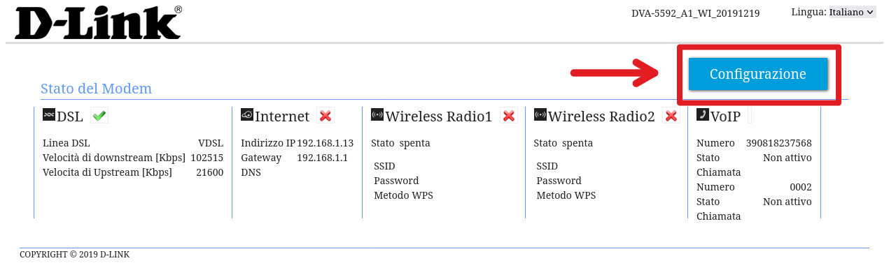
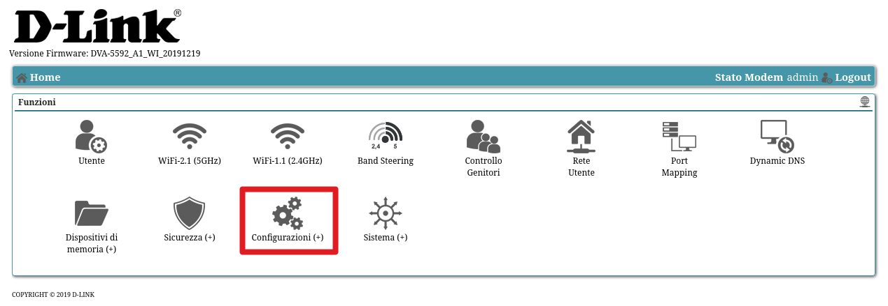
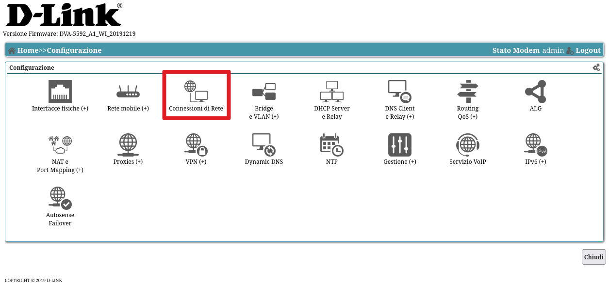
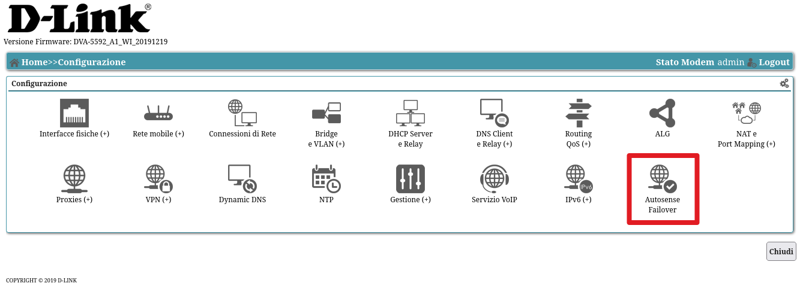
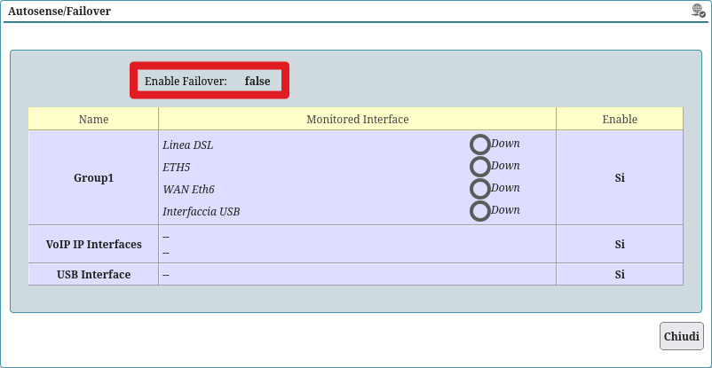

## Introduzione

E' possibile utilizzare il modem D-Link DVA5592 in combinazione con un altro router. Con questo setup il DVA farà solo da modem VDSL e centralino VOIP per le chiamate.

> **NOTA**
>
> Questa guida dovrebbe funzionare anche per il DVA5593, ma non ho modo di testarlo

Questa guida è basata sul metodo 4 descritto in [questo thread](https://www.dlink-forum.it/d/3801-come-collegare-un-altro-router-al-dva-5592-dva-5593) del forum D-Link italia. L'unica differenza è la disattivazione dell'autosense failover che causa problemi al riavvio del modem (procedura descritta alla fine).

## Eliminazione delle connessioni WAN esistenti

Eliminare tutte le connessioni WAN esistenti:

1. Accedere al pannello web del modem ([http://192.168.1.1/](http://192.168.1.1/) - potrebbe essere diverso)
2. Eseguire il login con le credenziali (nome utente `admin`, la password dovrebbe essere scritta sull'etichetta del modem)
3. Configurazione
	
4. Configurazioni
	
5. Connessioni di rete
	

**GUIDA INCOMPLETA, SEGUIRE IL THREAD ORIGINALE**

## Creazione bridge WAN

Segui la guida nel thread

## Disabilitare l'Autosense Failover

Una volta completato il tutto il setup funzionerà finche non si riavvia il modem (può capitare ad esempio se salta la corrente). Il problema principale è l'Autosense Failover, una feature che permette al modem di permutare la connessione ad internet nel caso in cui quella scelta non funzioni. In questo caso, il modem disabilita il DSL in favore della porta ethernet 5 (quella impostata prima come nuova WAN). Disabilitare l'Autosense Failover rimane l'unica soluzione che ha funzionato per me. Purtroppo non si può disabilitare con l'interfaccia web standard, quindi si deve utilizzare [adbtools2](https://github.com/digiampietro/adbtools2) per modificare il file di configurazione del modem (per utilizzarlo leggi le istruzioni su GitHub). Il file da modificare è il config CPE che va prima salvato in XML e poi modificato a mano.

Nella sezione `<X_ADB_InterfaceMonitor>` si deve cambiare il valore di `<Enable>` da "true" a "false":
```diff
...
	<X_ADB_InterfaceMonitor>
-		<Enable>true</Enable>
+		<Enable>false</Enable>
		<Group id="1">
			<Enable>true</Enable>
			<Name>Group1</Name>
			<Interface id="1">
				<Enable>true</Enable>
				<StartupTimeout>0</StartupTimeout>
				<Name>DSL Interface</Name>
...
```
Una volta fatto, si può ricreare il file .bin con la nuova configurazione modificata e ricaricarla nell'interfaccia web del modem. Una volta riavviato nell'interfaccia web l'Autosense Failover dovrebbe risultare disabilitato. Per controllare:

1. Nella sezione **Configurazioni**, vai nella sezione **Autosense Failover**:
	
2. Controlla se **Enable failover** riporta **false**:
	