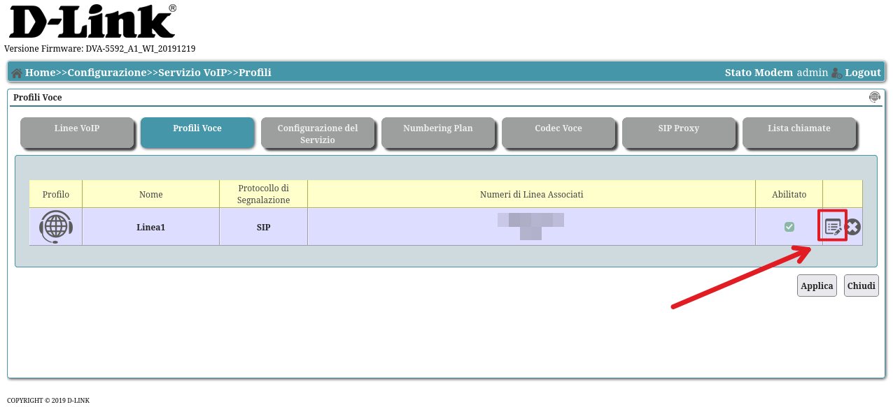
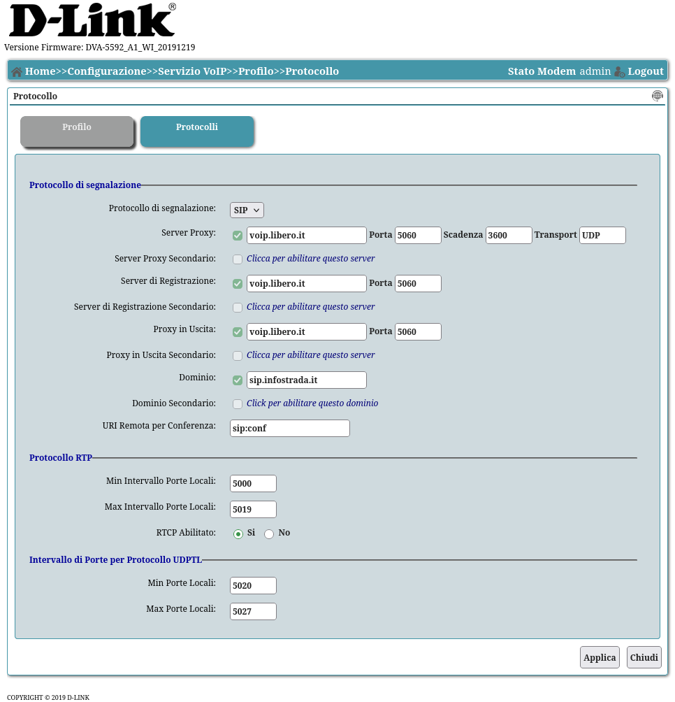
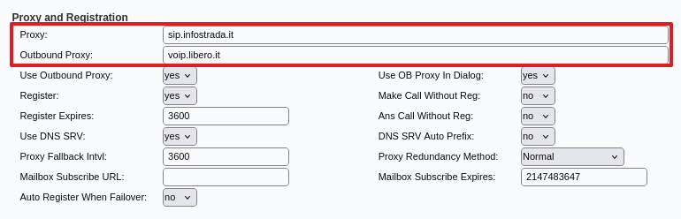

## Introduzione

E' possibile configurare l'adattatore ATA Cisco SPA122 con il voip fornito da una linea Windtre business. La procedura è uguale a quella descritta in [questa guida](https://www.sandon.it/2020/09/02/configurazione-ata-cisco-spa-112-con-voip-windtre/) (per Cisco SPA112), vanno solo cambiati alcuni valori.

## Proxy e Outbound Proxy

Cercando nella configurazione originale del DVA5592 (modem fornito da Windtre), ci sono dei valori che differiscono da `voip.windtre.it` e `windtre.it`. Per controllare:

1. Andare in **Configurazioni** > **Servizio VoIP** > **Profili voce** (potrebbe essere necessario sbloccare il modem con [adbtools2](https://github.com/digiampietro/adbtools2))
    

2. Premendo sul tasto a destra per modificare il profilo (vedi immagine di prima), si può visualizzare la pagina **Protocolli**:
    

Si può notare che il proxy in uscita è `voip.libero.it`, mentre il dominio è `sip.infostrada.it`. Questa distinzione è importante, perchè il Cisco si deve connettere al primo soltanto, mentre deve usare il dominio nel campo `From` (dovrebbe essere `From <390xxxxxxxxx@sip.infostrada.it>` - le x dovrebbero essere il numero di telefono, potete confermare facendo una cattura dei pacchetti). Quindi nel pannello di configurazione web dell'adattatore le impostazioni devono essere impostate così (in **Voce** > **Line 1**):

